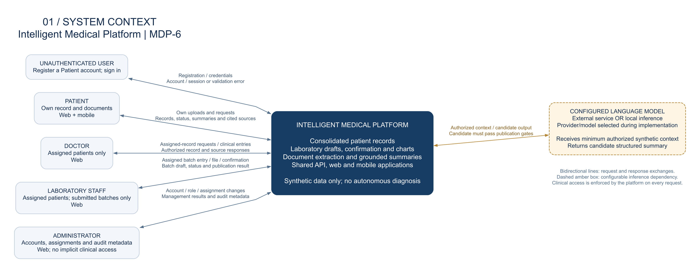
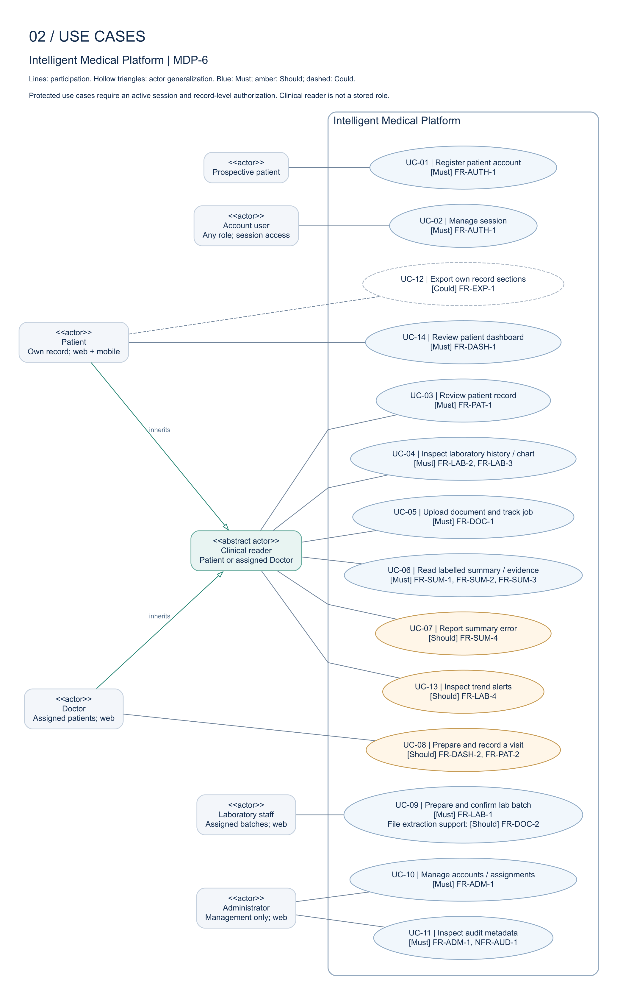
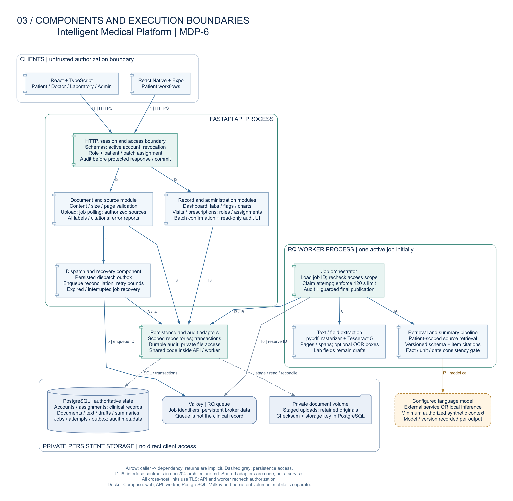

# Architecture diagrams and design

| Item | Value |
| --- | --- |
| Project | Intelligent Medical Platform |
| Work item | [MDP-6 — Architecture diagrams (context, use case, component)](https://nauka11.youtrack.cloud/issue/MDP-6) |
| Milestone | M1 pre-defense-1; 24 October 2026 |
| Document date | 24 October 2026 |
| Design basis | [Project proposal](01-proposal.md), [MDP-5 requirements baseline][REQ], [technology decisions](https://github.com/nauka2103/med-data-platform/blob/2a35a58d34c10e4a5ee141bb7f8b99911fcfbeba/docs/03-technology-comparison.md) |
| Deliverables | Three editable Graphviz DOT sources, PNG exports and SVG exports in [`/diagrams`](../diagrams/) |

## 1. Architectural scope

The platform is a modular application with a shared FastAPI API, a React web client, a React Native/Expo patient client, PostgreSQL, private document storage and a separate Python processing worker. RQ and Valkey provide asynchronous execution. The API and worker share domain policies and versioned data contracts; domain modules do not require separate microservices.

This document specifies the target architecture for the diploma prototype. Its diagrams describe responsibilities and boundaries; they do not assert that application code or measured quality targets have already been delivered. Development, demonstration and evaluation use synthetic records. Hospital integration, autonomous diagnosis, treatment recommendations and real patient data are outside scope.

Requirement identifiers refer to the published MDP-5 specification at commit `dbc7bd494a214f10adacbbcf0761b6ae575d8d30`. This fixed baseline is used because the specification is published on another repository branch. Must, Should and Could retain their meanings from that specification.

## 2. System context



*Figure 1. External actors exchange requests and responses with one platform. The model is a configurable inference dependency; candidate output is not a published clinical record.*

[Editable DOT](../diagrams/01-system-context.dot) · [Full-size PNG](../diagrams/01-system-context.png) · [Scalable SVG](../diagrams/01-system-context.svg)

| Actor | Interaction and access boundary |
| --- | --- |
| Unauthenticated user | Register a Patient account and sign in. Public registration cannot create a privileged role. |
| Patient | Use web or mobile to inspect their own record, dashboard and laboratory history; upload documents; inspect job status, labelled summaries and their evidence. A patient cannot publish laboratory results or edit clinician-authored records. |
| Doctor | Use web to access actively assigned patients. The same assignment boundary applies to lists, individual records, uploads, jobs, summaries and source files. Visit notes, prescriptions and the doctor overview are Should capabilities. |
| Laboratory staff | Use web to prepare and confirm batches for assigned patients. Access is limited to assigned patient identifiers/display names and the submitted batch with its processing result. General clinical history and document summaries are not exposed. |
| Administrator | Manage accounts, roles and assignments, and inspect read-only audit metadata. Administrative authority alone does not grant clinical access. |

The configured language model may be an external service or local inference. The provider, model and retrieval implementation are not fixed by MDP-4. An adapter isolates those choices from the domain workflow. Only the minimum synthetic source material and authorized patient context for the current job may cross that boundary; tokens, unrelated records and unrestricted database access are excluded.

## 3. Use cases



*Figure 2. Associations identify participation, not execution order. Actor generalization shares Patient/Doctor interactions without creating a new application role. Authorization remains a precondition of each protected use case.*

[Editable DOT](../diagrams/02-use-cases.dot) · [Full-size PNG](../diagrams/02-use-cases.png) · [Scalable SVG](../diagrams/02-use-cases.svg)

| Use case | Actor and observable outcome | Requirements |
| --- | --- | --- |
| UC-01 — Register patient account | A prospective patient creates one valid Patient account without authentication; duplicate or invalid input creates no account. | FR-AUTH-1 |
| UC-02 — Manage session | An account user signs in or signs out. Expired, revoked and logged-out sessions cannot authorize subsequent requests. | FR-AUTH-1 |
| UC-03 — Review patient record | A patient or assigned doctor reads demographics, visits and recorded prescriptions in date order. | FR-PAT-1, FR-AUTH-2 |
| UC-04 — Inspect laboratory history and chart | A patient or assigned doctor selects an analyte, unit and inclusive date interval; table, chart and supplied-range indicators agree. | FR-LAB-2, FR-LAB-3 |
| UC-05 — Upload document and track job | A patient or assigned doctor uploads a supported document and receives stable document/job IDs; status survives refresh and exposes readable failure reasons. | FR-DOC-1 |
| UC-06 — Read labelled summary and evidence | A patient or assigned doctor reads a schema-valid, source-grounded summary that passed the consistency gate, and can open the evidence for each factual item. | FR-SUM-1, FR-SUM-2, FR-SUM-3 |
| UC-07 — Report summary error | A patient or assigned doctor stores a report against a specific summary version; the report does not silently modify its source. **Should.** | FR-SUM-4 |
| UC-08 — Prepare and record a visit | An assigned doctor opens the patient overview and adds attributed visit/prescription records. **Should.** | FR-DASH-2, FR-PAT-2 |
| UC-09 — Prepare and confirm laboratory batch | Laboratory staff enter a draft for an assigned patient, correct/validate its fields and explicitly confirm it once. Structured entry is **Must**; file extraction assistance is **Should**. | FR-LAB-1, FR-DOC-1, FR-DOC-2 |
| UC-10 — Manage accounts and assignments | An administrator provisions roles, deactivates accounts and changes doctor/laboratory assignments. Changes take effect on the next protected request. | FR-ADM-1, FR-AUTH-2 |
| UC-11 — Inspect audit metadata | An administrator reads audit metadata without clinical bodies; application users cannot edit or delete audit events. | FR-ADM-1, NFR-AUD-1 |
| UC-12 — Export own record sections | A patient exports only selected own-record sections, preserving units, dates, AI labels and source identifiers. **Could.** | FR-EXP-1 |
| UC-13 — Inspect trend alerts | A patient or assigned doctor inspects a rising/falling alert and its contributing measurements. **Should.** | FR-LAB-4 |
| UC-14 — Review patient dashboard | A patient sees the latest published values per analyte/unit, visits, prescriptions and document statuses, with distinct loading, empty and error states. | FR-DASH-1 |

Patient scenarios S1 and S2 run on both clients against the same persisted records (FR-UI-1). Doctor scenario S3 and laboratory scenario S4 are web workflows. Mobile doctor/laboratory/admin workflows are outside the initial mobile scope. Trend alerts and error reports are planned Should capabilities; their absence must not prevent the mandatory dashboard or source-inspection workflow.

## 4. Components and execution boundaries



*Figure 3. Process clusters contain logical components. Arrows identify the caller and its dependency; returns are implicit. Clients have no direct database, queue, filesystem or model access.*

[Editable DOT](../diagrams/03-components.dot) · [Full-size PNG](../diagrams/03-components.png) · [Scalable SVG](../diagrams/03-components.svg)

| Component | Responsibility and persisted outputs |
| --- | --- |
| Web client — React/TypeScript | Patient, doctor, laboratory and administrator views. Uses the shared API; renders units, dates, per-result ranges, processing states and source links. Hidden controls do not enforce authorization. |
| Mobile client — React Native/Expo | Patient login, dashboard, charts, upload, summary and evidence navigation. Handles picker cancellation, local file readability and session expiry. |
| HTTP/session/access boundary — FastAPI | Request schemas, account activation, revocable sessions, role checks and record/batch assignments. Every protected route, list, nested identifier and file request passes through this boundary. |
| Record and administration modules | Patient records, visits/prescriptions, laboratory drafts and publication, range flags, history, dashboard aggregation, assignments and audit viewing. Analyte/unit/date queries use structured database fields. |
| Document and source module | File validation and staging, retained source delivery, document/job metadata, polling, versioned summary responses, citations and error reports. A laboratory batch job cannot grant general-summary access. |
| Dispatch and recovery component | Durable dispatch intent, enqueue reconciliation, bounded retries and expired/interrupted-job recovery. It runs at API startup and periodically in the API process, independently of worker availability. |
| RQ job orchestrator | Reserve a job ID, load its authorized context, claim a processing attempt, enforce timeout, call extraction/summarization and commit guarded final state with audit metadata. |
| Text/field extraction | Extract usable digital PDF text with pypdf; rasterize scanned pages and run Tesseract 5; preserve page/span identity and OCR boxes where available. Lab fields are drafts, and missing fields remain missing. |
| Retrieval and summary pipeline | Retrieve only authorized patient context, request a candidate through the model adapter, validate its versioned schema/citations and check associated numbers, units, medication names and dates before publication. |
| Shared persistence and audit adapters | Repository, transaction, durable audit and private-file operations invoked inside the API/worker processes. This shared code is a logical component, not a network service or an authorization bypass. |
| PostgreSQL | Authoritative accounts, sessions, assignments, clinical records, batches, document metadata/text, source references, summary versions, job attempts, dispatch outbox and audit events. |
| Private document volume | Staged files and retained originals. PostgreSQL stores opaque storage keys, ownership and checksums. The API mediates every download; filesystem paths are never client authority. |
| Valkey | Persistent RQ broker state and job identifiers. Queue contents and queue result TTLs do not define the patient record or the durable processing status. |

Audit enforcement is a shared application responsibility used by API and worker operations. It is shown inside their boundary/orchestrator components and persisted in PostgreSQL, rather than modeled as a separate unaudited logging service. Clinical text and credentials do not enter application logs or audit bodies.

### Interface contracts

| ID / boundary | Required contract |
| --- | --- |
| I1 — Client → API | HTTPS with schema-validated JSON and multipart files. Authentication is resolved server-side; account/assignment state is checked on each request. Protected lists, job polling, citations and downloads follow the same policy. |
| I2 — Access boundary → domain modules | Pass verified actor and resource scope; each domain operation retains its role/record rules. Current session and assignment state is checked independently of client input. |
| I3 — API/worker → persistence adapters | Parameterized access and explicit transactions. Batch confirmation is atomic and keyed by a stable batch ID; clinical mutation and its audit event commit together. Validate upload content, size (at most 10 MiB) and PDF page count (at most 20); reject corrupt, encrypted/unreadable or unsupported files. Stage files before dispatch metadata and reconcile incomplete uploads. |
| I4 — Document module → dispatch/recovery | Commit the job and a dispatch outbox row in the same database transaction before returning success. Reconcile unsent intents and expired/interrupted attempts at startup and periodically. |
| I5 — Dispatch/worker → queue | Enqueue/reserve stable application job identifiers; the worker loads current state from PostgreSQL. Durable dispatch intent bridges the database/enqueue gap. Retries and duplicate delivery are expected; exactly-once execution is not assumed. |
| I6 — Orchestrator → processing modules | Pass versioned source text/spans and authorized scope. Receive inspectable extraction drafts and a validated candidate outcome. Missing/unreadable inputs and gate failures are explicit results. |
| I7 — Summary pipeline → model | The adapter passes bounded, authorized synthetic context and expected schema. Record model/version and processing configuration. A model response is a candidate until source, schema and consistency checks succeed. |
| I8 — Worker → publication transaction | Compare job state, active attempt ID, deadline and current access scope; reject a timed-out, superseded or revoked attempt. Persist outputs, terminal state and audit metadata atomically. |

Transport protection applies to all cross-host service links, including database, broker and model connections. Loopback-only local development may use HTTP as specified by NFR-SEC-1. Storage and queue endpoints are private; the web/mobile clients reach only the API.

## 5. Principal workflows and failure behavior

### Laboratory publication

1. Authenticate laboratory staff and verify an active assignment to the selected patient.
2. Create a draft batch through structured entry, or attach a lab report and inspect its extraction draft when FR-DOC-2 is available. The structured path remains usable after extraction failure.
3. Validate patient, analyte, finite numeric value, unit, measurement date and supplied limits. Staff correct fields and explicitly confirm the stable batch ID.
4. In one transaction, lock/check the batch, publish its results and persist the audit event. A unique publication constraint and state guard prevent duplicate results under replay or concurrent confirmation.
5. The refreshed patient dashboard and history read only published results. Different units form separate series; equal-date results use stable result IDs to break ties. Missing ranges display Not assessed; range flags and trend alerts do not state a diagnosis.

### Document processing and publication

1. Validate the caller's patient/batch scope and the file before accepting the workflow. Retain the validated original; atomically persist document metadata, the job and a dispatch outbox row. Return document/job IDs without waiting for model inference.
2. Dispatch/reconcile the job ID to RQ. The worker rechecks account/assignment scope and claims a versioned attempt in PostgreSQL. Broker persistence is supplementary to the database's durable job state.
3. Move the document from `uploaded` to `processing`. Extract inspectable text from digital pages or rasterize/OCR scans. Store versioned text and stable page/span references. Extracted lab values remain separate drafts.
4. For patient/doctor documents, retrieve authorized context and generate a candidate summary. Check the schema, AI label, item-level evidence and associated facts. Source-recorded diagnoses/recommendations may be reproduced with attribution; new clinical advice is not generated. Lab-batch jobs produce batch drafts/status and do not expose general summaries to laboratory staff.
5. Publish `ready` only when the required checks pass and the active attempt remains authorized, current and within its processing deadline. Store the summary/version, source links, job outcome and audit event in the guarded transaction. `ready` for a lab-batch job means its processing draft is available, not that laboratory values have been confirmed.
6. On unreadable input, OCR/model error, invalid citations, consistency failure or more than 120 seconds of processing, terminate as `failed` with a readable reason and no ready summary. Queue wait is reported separately from the processing timeout. A late response cannot overwrite a failed or superseded attempt.
7. Both clients poll durable server state. They distinguish loading, empty, processing failure and authorization failure. Where source extraction succeeded, authorized patients/doctors retain original/text inspection even if later summarization fails; a failed summary never appears as ready.

Recovery reconciles pending dispatch rows, processing attempts and retained files on startup and periodically. An interrupted job must be retried within the configured attempt bound or explicitly failed; it cannot remain indefinitely processing. An attempt ledger and publication guards prevent duplicate summaries/batches. A crash after upload staging is resolved by storage reconciliation because database transactions do not atomically commit filesystem writes.

### Authorization and audit failures

Patients are scoped to themselves; doctors to active assignments; laboratory users to assigned patients and their submitted batches. Administrator operations use separate management permissions. Assignment revocation and account deactivation are checked on the next request and again before worker publication. The server resolves ownership independently for nested document, job, summary and evidence identifiers.

Every protected read/write, source download, denied protected request and administrative mutation requires a durable audit event containing actor/anonymous marker, action, resource ID, outcome, timestamp and correlation ID. Writes commit their event in the same database transaction; reads persist the event before response/file streaming begins. If audit persistence is unavailable, the operation returns an error without clinical payload or mutation. Administrators can inspect metadata only; no application role can edit/delete audit events. Passwords, tokens, original text and summary bodies are excluded from logs.

## 6. Requirement traceability

| Requirements | Architecture allocation and diagram evidence |
| --- | --- |
| FR-AUTH-1, FR-AUTH-2 | Context actor boundaries; UC-01/02 and protected-use-case preconditions; API session/assignment policy and worker scope recheck. |
| FR-PAT-1, FR-PAT-2, FR-DASH-2 | UC-03/08; record modules and PostgreSQL; doctor web workflow retains Should priority. |
| FR-LAB-1 | Laboratory actor; UC-09; record-module confirmation transaction, stable batch ID and draft/published separation. |
| FR-LAB-2, FR-LAB-3, FR-LAB-4 | UC-04/13; laboratory flags/history and dashboard aggregation; analyte/unit grouping, supplied limits and source-linked Should trends. |
| FR-DOC-1, FR-DOC-2 | UC-05/09; document module, private originals, outbox, RQ worker, pypdf/Tesseract and draft extraction; durable state and bounded timeout. |
| FR-SUM-1, FR-SUM-2, FR-SUM-3, FR-SUM-4 | UC-06/07; authorized retrieval, model adapter, schema/citation/consistency gates, AI labels, source delivery and versioned Should error reports. |
| FR-DASH-1, FR-UI-1 | UC-14 and patient participation in UC-03/04/05/06; two clients use one API and shared PostgreSQL records. |
| FR-ADM-1 | Administrator actor; UC-10/11; management permissions, role provisioning, assignments and read-only audit metadata. |
| NFR-SEC-1, NFR-PRIV-1 | Revocable sessions, salted adaptive password hashing during implementation, server-side authorization, private storage, TLS and synthetic-only processing with bounded model context. |
| NFR-AUD-1 | Shared audit policy in API/worker, durable PostgreSQL events and failure-before-disclosure/commit behavior. |
| NFR-ACC-2 | Summary consistency/publication boundary plus the fixed held-out and human evaluation procedure owned by MDP-8; a passing checker alone does not establish faithfulness. |
| NFR-AVL-1 | Compose service boundaries, persistent volumes, durable outbox/attempt state and restart reconciliation. |
| NFR-PERF-1, NFR-PERF-2 | Indexed/aggregated dashboard reads; asynchronous OCR/model execution and one active job initially; benchmark targets remain subject to measurement. |
| NFR-ACC-1 | Versioned text/draft/source outputs from extraction; fixed-set comparison against the rule-based parser. |
| NFR-USE-1, NFR-MAINT-1 | Explicit web/mobile states and scoped scenarios; shared contracts and separable modules support automated authorization, boundary and failure checks. |
| FR-EXP-1, NFR-I18N-1 | UC-12 is Could; any export passes API authorization/source-label rules. English/Russian localization is Could client presentation work and does not alter original text or unit semantics. |

## 7. Deployment and implementation decisions

Docker Compose will start the web client, API, RQ worker, PostgreSQL and Valkey, with persistent database, broker and document volumes. Mobile build/development setup is separate and uses the same reachable API. The browser-visible API address must be reachable by the test device; an emulator/device does not use the API container's internal hostname. The model adapter connects to the documented external provider or local inference process required for the evaluated configuration.

The API and worker use a shared Python codebase but run separately so document processing does not occupy an HTTP request. CPU-heavy OCR and model latency do not belong in FastAPI request/background-task execution. PostgreSQL is the durable source of truth; no queue cache is required to reconstruct published records.

Exact authentication packages, model/provider, retrieval index, PDF rasterizer, charting libraries and pinned dependency/container versions remain implementation decisions, consistent with MDP-4. PostgreSQL-scoped retrieval is a logical boundary here; no vector database or unselected embedding service is assumed. Optional export/localization and Should features do not introduce new process boundaries. Evaluation under MDP-8 must measure extraction, summary faithfulness, response time, recovery and usability against the published targets before claiming them as achieved.

## 8. Diagram sources and reproduction

| View | Editable source | PNG export | SVG export |
| --- | --- | --- | --- |
| System context | [01-system-context.dot](../diagrams/01-system-context.dot) | [PNG](../diagrams/01-system-context.png) | [SVG](../diagrams/01-system-context.svg) |
| Use cases | [02-use-cases.dot](../diagrams/02-use-cases.dot) | [PNG](../diagrams/02-use-cases.png) | [SVG](../diagrams/02-use-cases.svg) |
| Components | [03-components.dot](../diagrams/03-components.dot) | [PNG](../diagrams/03-components.png) | [SVG](../diagrams/03-components.svg) |

The DOT files are the editable source of truth. SVG permits zooming without text rasterization; PNG supports document insertion. Re-export all three views with [Graphviz](https://graphviz.org/) installed:

```sh
sh diagrams/render.sh
```

The provided exports were laid out with Graphviz 16.1.0 through [Viz.js](https://viz-js.com/api/) and rasterized at 160 dpi. The script uses native Graphviz at the same DPI; font availability and renderer versions can cause minor visual differences without changing graph content. Edit the DOT sources, regenerate both formats and review their labels and requirement links together.

[REQ]: https://github.com/nauka2103/med-data-platform/blob/dbc7bd494a214f10adacbbcf0761b6ae575d8d30/docs/06-requirements.md
